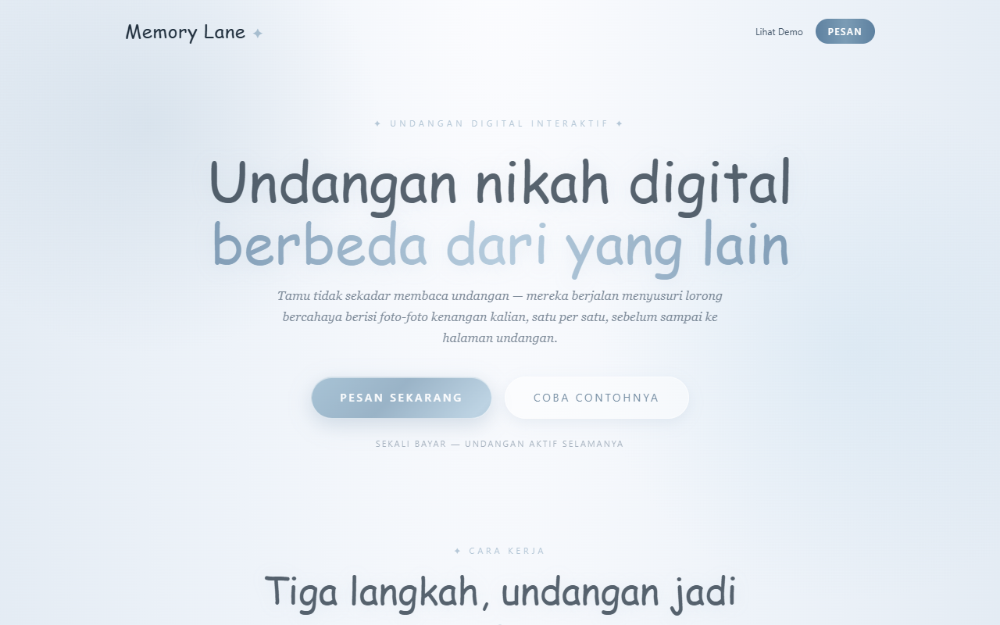
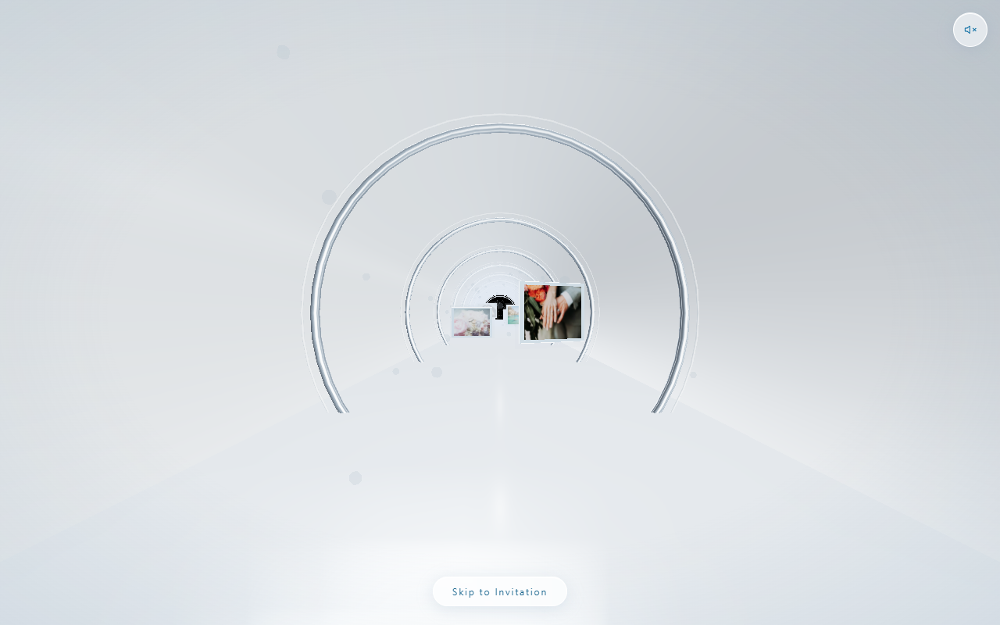
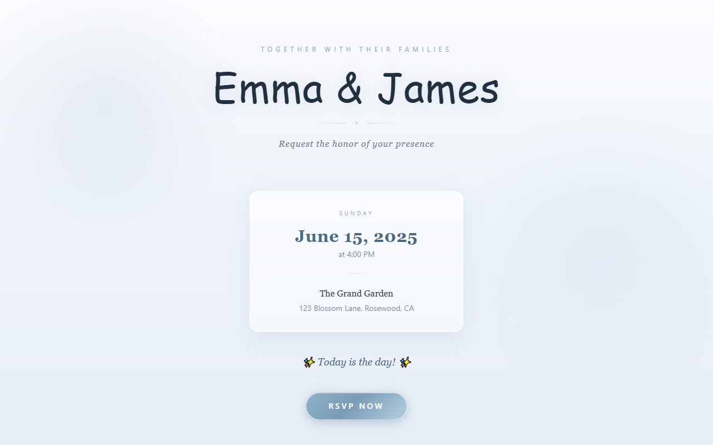
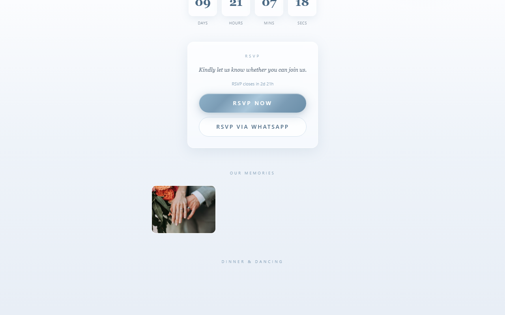
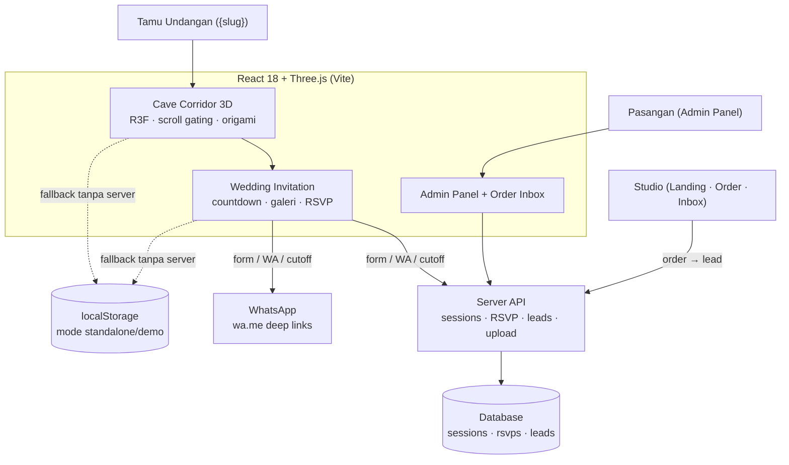

# Memory Lane — Undangan Pernikahan 3D yang Bisa Dijelajahi

**Tamu bukan cuma membuka undangan — mereka *menyusuri lorong memori* 3D, lalu tiba di undangan pernikahan Anda.**

| Studio Landing | Lorong Memori 3D |
|:---:|:---:|
|  |  |

| Undangan Pernikahan | RSVP Tamu |
|:---:|:---:|
|  |  |

---

## Masalahnya

- Undangan digital sekarang cuma **PDF atau link statis** — dibuka 3 detik, ditutup, dilupakan
- Pasangan ingin cerita perjalanan cinta mereka **terasa hidup**, bukan sekadar galeri foto
- Studio pernikahan butuh cara **menjual & mengelola** undangan seperti produk: order, produksi, serah terima

## Memory Lane

Pengalaman undangan pernikahan **3D interaktif** yang dijual studio sebagai produk digital — satu pasangan, satu sesi, satu pengalaman yang tidak terlupakan.

### Perjalanan Tamu

1. **Buka Undangan** — gerbang sinematik membuka lorong
2. **Cave Corridor 3D** — koridor lengkung bertema *Sky & Pearl*: dinding gading, cincin arch metalik mutiara, lantai memantul, kabut lembut, percikan *fairy embers*
3. **Memory Photos** — foto-foto tergantung di dinding koridor; ketuk → kertas *membuka seperti origami* dengan cerita di baliknya, tutup → melipat kembali
4. **Origami Crane** — di ujung lorong, satu burung kertas meluncur menyeberangkan tamu ke…
5. **Wedding Invitation** — nama pasangan, countdown, galeri, dan **RSVP**

### Fitur

- **3D sungguhan** — Three.js + react-three-fiber: dolly entry, scroll gating per foto, fog + partikel, jalan penuh di HP
- **RSVP komplet** — form (hadir/ragu/tidak + jumlah tamu + pesan + nomor WA), **RSVP via WhatsApp satu-tap**, cutoff otomatis 7 hari sebelum acara (form terkunci + countdown), satu jawaban per tamu & bisa diubah
- **Tools pasangan** — export CSV + ringkasan WhatsApp, chat per-tamu, panel admin (detail, musik, foto)
- **Multi-tenant untuk studio** — setiap pasangan = 1 session dengan slug unik (`/{slug}`); **Order Inbox** dengan pipeline Baru → Dihubungi → Jadi/Batal + chat WhatsApp; harga & nomor studio bisa diganti tanpa rebuild
- **Audio per sesi** — lagu request pasangan, fallback ambient generatif
- **Standalone demo** — mode tanpa server (data di browser) untuk showcase instan

---

## Arsitektur

- **Stack:** React 18 · Three.js 0.170 + @react-three/fiber + drei · Vite · Tailwind · server API (sessions/RSVP/leads) · deep-link WhatsApp · Capacitor (paket mobile)
- **Desain:** tema *Sky & Pearl* — ivory, perak mutiara, biru langit; UI bersih tanpa ornamen (sejak v3.2); polish micro-interaction terdokumentasi rapi (frame menghadap jalur, placeholder loading tersembunyi, anti-scroll-dead bug fix)

---

## English

**Memory Lane** is a 3D wedding invitation that guests can walk through. Instead of a static link, guests follow a memory corridor and arrive at the couple's invitation.

It is built for Indonesian weddings where the invitation itself is part of the celebration, and runs in the browser without an install.

The source code is not published; this repository documents the product.

---

## Tentang Source Code

Repository ini adalah **showcase** — dokumentasi produk, bukan kode sumber.
Source code Memory Lane tidak dipublikasikan dan semua hak dilindungi. Lihat [`LICENSE`](LICENSE).

> Demo, kolaborasi, atau lisensi? Hubungi [Kandar Lubis](https://github.com/kandarlubis31).

---

© 2026 Kandar Lubis — All Rights Reserved.
